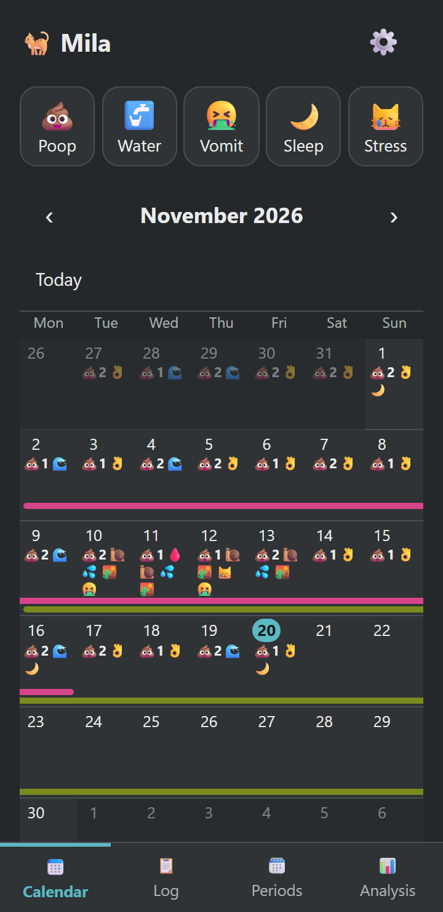
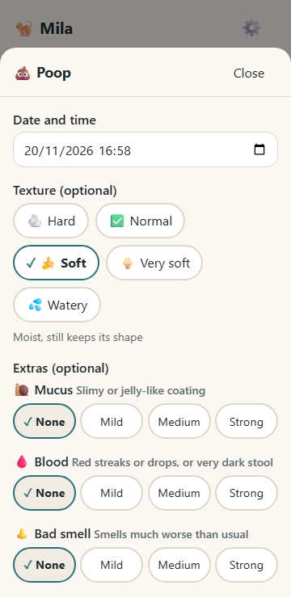
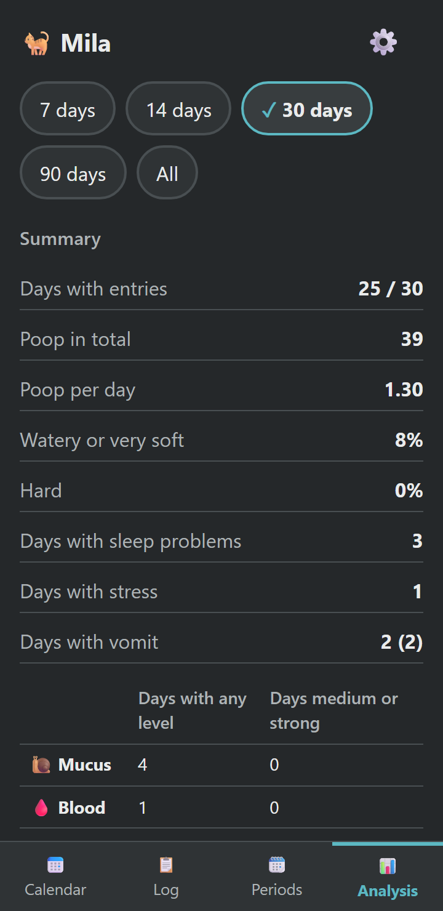

# catlog

A health diary for your cat. It works in the browser, also offline. **Your data stays on your phone.**

[](https://github.com/catlog-app/catlog/actions/workflows/ci.yml)
[](LICENSE)

<p>
  
  
  
</p>

> **Not a medical app.** This is a personal diary, not a diagnosis. If your cat looks unwell, call a vet.

## What it does

- Write down **poop** (texture, mucus, blood, smell), **water**, **sleep problems** and **stress**. All details are optional.
- Add **special periods**, like a new food or a medicine. Periods can overlap. They show as colored bars in the calendar.
- Look at a **calendar**, a **log** and an **analysis** for 7, 14, 30 or 90 days.
- Keep **more than one cat**.
- **Export** to Excel (`.xlsx`) or CSV. Copy a short **summary for your vet**.
- **Back up** to a file and **import** it later.
- No account, no server, no ads, no tracking. After the app loads, it makes no network requests.

## Install on Android

Use **Chrome**. Open the app link. The link is on the repository page, under **About**.

Menu (⋮) → **Install app**. Do not choose “Create shortcut”: it opens as a browser tab and shows a browser icon.

Then open catlog from your home screen. It works without internet.

## Your data and backups

This part is important.

- Entries are saved in the storage of your browser (IndexedDB), on your phone. They never go to a server.
- The app files are cached for offline use. Clearing the cache (“cached images and files”) is **safe**. Your entries stay.
- Clearing **“cookies and site data”**, **“storage”** or the **app data** deletes **all entries**.
- When you uninstall the app, Chrome offers to clear the site data too. This can delete the entries. Back up first.
- Some browsers can delete site data when they close. Check this in your browser settings. The app cannot detect it.
- The app asks the browser to keep the data. The browser may say no. This does not protect from clearing by hand. Settings show the real answer.
- **Back up often.** Tap **Settings → Back up now**.
  - The share menu opens. You can send the file to Telegram, Drive or e-mail. If the browser cannot share files, the file is saved to Downloads.
- The app shows a reminder if your last backup is older than 14 days and you have new entries.
- The backup file is **not encrypted**. Keep it where only you can read it.

## Time zones

Every entry saves its own moment (UTC), time zone, local date and local time. If you travel or the rules of a time zone change, **old entries stay on their day**.
By default, the app follows your phone. In Settings you can choose a **fixed time zone**.
Periods use plain dates without a time zone: “new food from 12 Nov” is 12 Nov everywhere.

## About this project

catlog is a personal project of [daluury](https://github.com/daluury), made for the maintainer's own use. The idea, the decisions and the review are human. **The code was written with the help of AI** (Claude by Anthropic). Commits with AI help have a `Co-Authored-By` line.
Improvements are welcome. See [CONTRIBUTING.md](CONTRIBUTING.md).

The app tracks what the maintainer needs. If a symptom or a field is missing for you, make your own version: the [MIT license](LICENSE) lets you copy and change the code. Keep the license notice.

Status: version 0.1. The automatic tests run in Chromium. The app was also tried on a real phone, see [Tested on a real phone](#tested-on-a-real-phone).

## Run it on your computer

You need Node.js 22 or newer.

```sh
npm ci
npm run dev        # development server
npm test           # unit tests
npm run test:e2e   # browser tests (first run: npx playwright install chromium)
npm run build      # production build in dist/
```

## Deploy your own copy

1. Fork the repository.
2. In **Settings → Pages**, set **Source** to **GitHub Actions**.
3. Push to `main`. The workflow builds and deploys. The path (`/<repo-name>/`) is set by itself.

**Use a separate origin.** Browser storage belongs to the origin (for example `name.github.io`), not to the path.
Any other site on the same origin can read the data of the app. Do not host other or untrusted JavaScript on the same origin. A GitHub organization only for this app, or your own domain, is best.

## How it is built

| Part    | Choice                                     | Why                                                               |
| ------- | ------------------------------------------ | ----------------------------------------------------------------- |
| UI      | Preact, TypeScript (strict)                | Small and simple. The app code is about 28 KB gzip.               |
| Styles  | Plain CSS with variables                   | No library. A strict policy without `'unsafe-inline'` for styles. |
| Storage | IndexedDB with `idb`                       | Not `localStorage`. Versioned upgrades.                           |
| Offline | `vite-plugin-pwa`                          | Caches app code only.                                             |
| Excel   | `write-excel-file` (MIT), loaded on demand | From npm, not from a CDN.                                         |
| Tests   | Vitest, Playwright                         | Pure logic is tested apart from the UI.                           |

Why a PWA and not an APK? A PWA needs no store, no signing and no developer account. It updates itself.
Google starts to require developer verification for apps outside the store, also for APK files.

```
src/
  logic/        pure functions: dates, time zones, lanes, daily, summary, export, backup
  ui/           Preact components
  db.ts         IndexedDB
  store.ts      app state, writes to the database first
  strings.ts    all text of the app (simple English, B1)
e2e/            Playwright tests
```

The app has a strict Content Security Policy in a `<meta>` tag: only its own files, `connect-src 'none'`.
GitHub Pages cannot send headers, so this is the best option. See [SECURITY.md](SECURITY.md).

## Tested on a real phone

Chrome on Android, November 2026:

- Installs as an app. It shows in the app list and has no browser icon.
- Opens and works in airplane mode.
- The backup goes through the share menu.
- After a backup and clearing the site data, the import brings all entries back.
- Clearing only the cache keeps the entries.
- Uninstalling the app keeps the entries, unless you also choose to clear the site data.

## License

[MIT](LICENSE)
